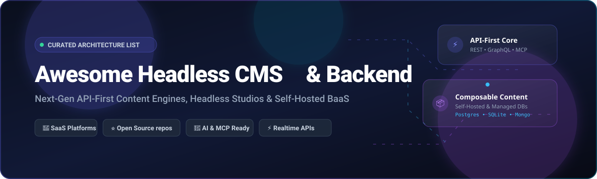

  

# 🚀 Awesome Headless CMS & Backend Ecosystem

### Curated Collection of Next-Gen Headless CMS, API-First Content Engines & Self-Hosted BaaS

  
  
  
  
  
  

**Discover high-performance headless content management systems, composable architectures, instant GraphQL/REST APIs, database-first studios, and self-hosted Backend-as-a-Service (BaaS) engines.**

---

## 📌 Table of Contents

- [🌐 Sector Overview & Market Dynamics](#-sector-overview--market-dynamics)
- [☁️ SaaS & Hosted Platforms](#️-saas--hosted-platforms)
- [⚡ Open-Source GitHub Projects](#-open-source-github-projects)
- [💡 Architectural Guide: How to Choose](#-architectural-guide-how-to-choose)
- [📈 Star History](#-star-history)
- [💖 Support & Sponsorship](#-support--sponsorship)
- [🤝 How to Contribute](#-how-to-contribute)
- [📜 Disclaimer & Licensing Notes](#-disclaimer--licensing-notes)

---

## 🌐 Sector Overview & Market Dynamics

The global headless CMS market is estimated at approximately **USD 2.0B to USD 4.2B in 2026** and is growing rapidly at a compound annual growth rate (CAGR) of **17%–21%**. 

From a market structure perspective, the sector is **moderately concentrated at the high-end enterprise layer**—anchored by established, well-capitalized platforms like Contentful and Sanity—yet remains **highly fragmented across the broader ecosystem**. The rise of MACH architecture (Microservices, API-first, Cloud-native SaaS, Headless), combined with specialized Git-based CMSs, Next.js full-stack frameworks, and powerful self-hosted open-source backends, prevents any single-vendor monopolization and gives developers supreme control over their data architecture.

---

## ☁️ SaaS & Hosted Platforms

A comprehensive, market-indexed comparison of premier managed headless CMS services. Sorted by company size / market footprint (descending).

| Platform | Company Size (Valuation / Revenue) | Starting Paid Pricing | Free Tier / Free Trial Limits | Description & Key Strengths |
| :--- | :--- | :--- | :--- | :--- |
| **[Contentful](https://www.contentful.com/)** | **USD 3.0B valuation** (~USD 350M total funding) | **USD 300/mo** (Lite tier) | **Free forever plan**: 1 space, up to 10 users, 25 content types, 10,000 records, 100K API calls/mo, 50 GB CDN bandwidth/mo, 2 locales. | Enterprise standard for API-first headless CMS. Mature content modeling UI, GraphQL/REST APIs, robust localization, and enterprise-grade governance (SSO, audit logs). |
| **[Storyblok](https://www.storyblok.com/)** | **~USD 800M+ valuation** (USD 138M funding, ~USD 80M ARR) | **USD 99/mo** (Growth tier; USD 90.75/mo billed annually) | **Free forever plan**: 1 space, 1 user seat, 100,000 API requests/mo, 100 GB traffic/mo, 2 locales. | Visual editor-first headless CMS with component-based content modeling and real-time live preview. Ideal for marketing teams and agencies. |
| **[Sanity](https://www.sanity.io/)** | **~USD 600M+ valuation** (USD 173M funding, >USD 40M ARR) | **USD 15/seat/mo** (Growth tier) | **Free forever plan**: 20 user seats, 2 datasets, 10,000 documents/dataset, 250K API requests/mo, 1M CDN requests/mo, 100 GB asset storage, 100 GB bandwidth/mo. | API-first headless CMS with real-time collaborative editing, GROQ/GraphQL query languages, and customizable React-based Studio. Best-in-class editor UX. |
| **[Strapi Cloud](https://strapi.io/)** | **~USD 200M valuation** (USD 49M funding, ~USD 10M ARR) | **USD 29/project/mo** (Starter tier; billed annually) | **14-day free trial** of full cloud features (no permanent cloud free tier; core self-hosted Community Edition is permanently free). | Managed cloud infrastructure for Strapi CMS with zero-DevOps deployment, automated backups, and CDN. Best for teams wanting Strapi without server maintenance. |
| **[Kontent.ai](https://kontent.ai/)** | **~USD 150M+ valuation** (USD 40M funding round) | **USD 990/mo** (Business tier; quote-based) | **Free Developer plan**: 2 environments, 2–3 users, 500 content items, 10,000 API calls/mo, 2 language variants. Also includes a **30-day free trial** of Business tier. | Enterprise-grade modular headless CMS with strong governance, content workflow engines, localization, and enterprise security certifications. |
| **[Prismic](https://prismic.io/)** | **~USD 90M valuation** (USD 20M funding, ~USD 15M ARR) | **USD 15/mo** (Starter tier) | **Free forever plan**: 1 user seat, 2 locales, unlimited documents, baseline CDN bandwidth (strictly no paid overages allowed on free tier). | Component-driven headless CMS with Slice Machine for Next.js, Nuxt, and SvelteKit architectures. Smooth developer experience for component-based websites. |
| **[Hygraph](https://hygraph.com/)** | **~USD 60M valuation** (USD 45M funding, ~USD 8M ARR) | **USD 199/mo** (Scale / Growth tier) | **Free forever plan (Hobby)**: 3 user seats, 1,000 content entries, 2 locales, 100 GB asset traffic/mo, 5 origin req/sec uncached rate limit. | GraphQL-native headless CMS with content federation capabilities, unifying data from external APIs, databases, and microservices into a single GraphQL endpoint. |
| **[Ghost Pro](https://ghost.org/)** | **USD 11.15M ARR** (Non-profit Foundation, USD 0 outside valuation) | **USD 15/mo** (Starter tier; USD 18/mo billed monthly) | **14-day free trial** with full feature access, no credit card required upfront (self-hosted open-source software is free forever). | Purpose-built managed platform for independent publishing, subscription newsletters, and digital media memberships with 0% platform fee on creator revenue. |

---

## ⚡ Open-Source GitHub Projects

Explore the most prominent open-source headless CMS engines, BaaS platforms, and API-first content layers. **Sorted by GitHub_Stars (descending)**, with real-time badges linking to stargazers.

### 1. **[Supabase](https://github.com/supabase/supabase)** 
- **Tech Stack**: PostgreSQL, Elixir, Go, TypeScript
- **Description**: The open-source Firebase alternative. Provides a dedicated Postgres database with instant REST and Realtime GraphQL APIs, row-level security (RLS), authentication, storage, and auto-generated TypeScript definitions. Acts as a modern, high-performance database-first headless backend.
- **Best For**: Full-stack application developers wanting complete SQL power and Postgres extensibility.

### 2. **[Strapi](https://github.com/strapi/strapi)** 
- **Tech Stack**: Node.js, TypeScript, React
- **Description**: The most widely adopted Node.js open-source headless CMS. 100% JavaScript/TypeScript, database-agnostic (SQLite, PostgreSQL, MySQL, MariaDB), featuring auto-generated REST/GraphQL APIs, visual Content-Type Builder, granular RBAC, internationalization, and an extensive community plugin ecosystem.
- **Best For**: Node.js engineering teams seeking maximum plugin extensibility and battle-tested community adoption.

### 3. **[PocketBase](https://github.com/pocketbase/pocketbase)** 
- **Tech Stack**: Go, SQLite
- **Description**: An open-source, single-binary backend consisting of embedded SQLite with realtime subscriptions, built-in auth management, file storage, and an elegant admin UI. Zero dependencies and effortless zero-maintenance deployment.
- **Best For**: Lightweight apps, mobile backends, Jamstack sites, and developers seeking single-file deployment simplicity.

### 4. **[Appwrite](https://github.com/appwrite/appwrite)** 
- **Tech Stack**: Docker, PHP, Node.js, MariaDB/PostgreSQL
- **Description**: A self-hosted Backend-as-a-Service platform that abstracts core development requirements into a set of REST and Realtime APIs. Includes user authentication, database management, file storage, scheduled background tasks, and serverless Cloud Functions.
- **Best For**: Cross-platform web, mobile (Flutter, React Native, Swift, Kotlin), and game developers needing ready-to-use backend APIs.

### 5. **[Ghost](https://github.com/TryGhost/Ghost)** 
- **Tech Stack**: Node.js, JavaScript, MySQL
- **Description**: The premier open-source headless publishing and journalism platform. Ships with rich publication and membership capabilities, newsletter delivery, dynamic webhooks, and Content & Admin REST APIs for fully custom headless frontends.
- **Best For**: Publishers, creator networks, editorial teams, and premium paid newsletters.

### 6. **[Payload CMS](https://github.com/payloadcms/payload)** 
- **Tech Stack**: Next.js, React, TypeScript, Node.js, PostgreSQL/MongoDB
- **Description**: The Next.js-native headless CMS. Installs directly into your `/app` directory with zero microservices needed. Fully TypeScript with automatic type generation, direct database access in React Server Components, customized React admin UI, and Lexical rich-text editing. MIT licensed.
- **Best For**: Next.js and React developers wanting an all-in-one full-stack TypeScript codebase.

### 7. **[Directus](https://github.com/directus/directus)** 
- **Tech Stack**: Node.js, TypeScript, Vue.js, SQL
- **Description**: The database-first alternative that layers instantly over any existing SQL database (PostgreSQL, MySQL, SQLite, OracleDB, CockroachDB) with instant REST and GraphQL APIs. Features a native Model Context Protocol (MCP) server for autonomous AI agents, workflow automation, and a visual data Studio without requiring schema migrations.
- **Best For**: Teams with existing SQL databases needing instant APIs, complex data relationships, and AI agent integration.

### 8. **[Medusa](https://github.com/medusajs/medusa)** 
- **Tech Stack**: Node.js, TypeScript, PostgreSQL, Redis
- **Description**: Composable, open-source commerce and headless content backend engine. Modular architecture that connects product catalogs, digital assets, checkout workflows, and multi-region fulfillment via modular REST APIs.
- **Best For**: Headless commerce platforms and brands needing custom editorial storefront experiences.

### 9. **[Hasura GraphQL Engine](https://github.com/hasura/graphql-engine)** 
- **Tech Stack**: Haskell, Go, PostgreSQL/SQL
- **Description**: Blazing-fast GraphQL and REST engine that connects directly to your databases and microservices, producing an instant, secure, unified data API with fine-grained role-based authorization.
- **Best For**: Data teams and enterprise architectures requiring instant GraphQL access over legacy or distributed databases.

### 10. **[Decap CMS](https://github.com/decaporg/decap-cms)** 
- **Tech Stack**: React, JavaScript, Git
- **Description**: Open-source Git-based CMS (formerly Netlify CMS). Runs as a single-page React app that edits Markdown, JSON, and YAML files directly inside your GitHub, GitLab, or Bitbucket repository.
- **Best For**: Static site generators (Hugo, Astro, Jekyll, Eleventy) with Git-native editorial versioning.

### 11. **[TinaCMS](https://github.com/tinacms/tinacms)** 
- **Tech Stack**: React, TypeScript, Next.js, Git
- **Description**: Git-backed headless CMS providing contextual, visual in-page editing for React and Next.js applications. Stores structured content as Markdown or MDX in your Git repository with automated GraphQL schema compilation.
- **Best For**: Next.js and React documentation or marketing sites needing real-time visual editing directly in Git.

### 12. **[KeystoneJS](https://github.com/keystonejs/keystone)** 
- **Tech Stack**: TypeScript, Node.js, GraphQL, Prisma
- **Description**: Code-first headless CMS and GraphQL backend framework. Define your schema purely in TypeScript and Keystone generates a complete GraphQL schema, Prisma database migrations, and an auto-generated React admin portal.
- **Best For**: Developers who prioritize code-first schema definitions, Prisma ORM workflows, and pure GraphQL endpoints.

### 13. **[Nhost](https://github.com/nhost/nhost)** 
- **Tech Stack**: Hasura, PostgreSQL, Node.js, Go
- **Description**: Open-source Firebase alternative with GraphQL. Combines PostgreSQL, Hasura GraphQL engine, built-in authentication, S3-compatible file storage, and serverless Node.js/TypeScript runtimes.
- **Best For**: GraphQL-first full-stack modern web and mobile applications.

### 14. **[ApostropheCMS](https://github.com/apostrophecms/apostrophe)** 
- **Tech Stack**: Node.js, Vue.js, MongoDB/PostgreSQL
- **Description**: Mature open-source content engine with contextual live preview, visual widget composition, multi-locale translation pipelines, and comprehensive headless REST APIs.
- **Best For**: Enterprise editorial workflows requiring contextual in-place previews alongside headless API distribution.

### 15. **[Squidex](https://github.com/Squidex/squidex)** 
- **Tech Stack**: .NET Core, C#, MongoDB/SQL
- **Description**: High-performance, enterprise-grade headless CMS written in .NET Core. Offers event-sourcing architecture, rich schema design, full CQRS compliance, and REST/GraphQL APIs.
- **Best For**: .NET and enterprise organizations looking for scalable event-driven content management.

---

## 💡 Architectural Guide: How to Choose

| Architecture Style | Recommended Platforms | Key Characteristics |
| :--- | :--- | :--- |
| **Database-First** | Directus, Supabase, Hasura | Wrap existing PostgreSQL/MySQL schemas with zero migration. Instant APIs, RLS security, and native AI/MCP integration. |
| **Framework-Native** | Payload CMS | Runs inside Next.js/React Server Components with TypeScript end-to-end. Single deployment artifact. |
| **Application-First** | Strapi, KeystoneJS | Code or visual modeling generates the schema and manages tables automatically. Broadest plugin ecosystem. |
| **Git-Backed** | TinaCMS, Decap CMS | Commits Markdown/MDX directly to Git. Perfect for Jamstack SSGs (Astro, Hugo, 11ty). |
| **Editorial & Publishing** | Ghost Pro, Storyblok, Sanity | Specialized publishing engines, newsletter dispatch, and real-time collaborative visual editors. |

---

## 📈 Star History

---

## 💖 Support & Sponsorship

Thank you for visiting and using this curated list! Maintaining and tracking the fast-moving headless CMS and backend ecosystem takes continuous curation and evaluation.

If you found this repository valuable, please consider:
- ⭐ **Starring** the repository to help other developers discover it.
- 🍴 **Forking** and contributing your own insights, PRs, and updates.
- 📢 **Sharing** on X/Twitter, LinkedIn, Discord, and developer communities.
- ☕ **Buying a coffee & sponsoring ongoing maintenance**: [Sponsor ishandutta2007 on GitHub Sponsors](https://github.com/sponsors/ishandutta2007)

Your support keeps this guide fresh, accurate, and completely community-driven! 🙏

---

## 🤝 How to Contribute

1. 🍴 Fork this repository.
2. 🌿 Create your feature branch (`git checkout -b feature/add-new-cms`).
3. 📝 Add or update entries following the established markdown schema (include name, Stars_Badge, tech stack, and key differentiators).
4. 🚀 Submit a PR with a concise explanation.

---

## 📜 Disclaimer & Licensing Notes

- This repository is a community-curated list compiled for educational, architectural, and developer reference.
- **Open-Source vs. Source-Available**: Strapi, Supabase, Payload CMS, PocketBase, KeystoneJS, Ghost, and Medusa are OSI-compliant open source (MIT, Apache 2.0, or AGPL). Directus utilizes the MSCL 1.0 (Fair Core License) which is free for organizations under $5M revenue / 50 employees, with commercial licensing above that threshold. Always verify licenses prior to production deployment.

---

  Built with ❤️ for full-stack engineers, content architects, and modern web builders.

